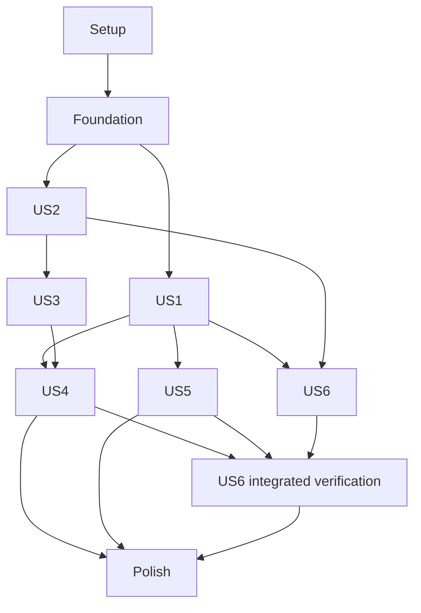

# Tasks: Upgrade Recipe Hosting and Shared Meal Shopping

**Input**: Design documents from `specs/001-upgrade-recipe-planner/`.
**Prerequisites**: [plan.md](plan.md), [spec.md](spec.md), [research.md](research.md), [data-model.md](data-model.md), [content contract](contracts/content-format.md), [HTTP/auth/operator contract](contracts/http-api.md), and [quickstart.md](quickstart.md).
**Status**: Setup and Foundation (T001–T017) are implemented and locally verified; see `docs/validation/foundation.md`. US1 (T018–T033) is implemented and verified in `docs/validation/us1.md`. US2 (T034–T043) is implemented and verified in `docs/validation/us2.md`; US3 (T044–T053) is implemented and verified in `docs/validation/us3.md`; US4 and later tasks remain unchecked, with partial T097 cleanup noted below. All approved analysis resolutions, including viewer-local A2, and task dependencies are preserved. The legacy Python source, tests, dependencies and service templates were subsequently removed by explicit user request. Production services remain unchanged; content migration and production cutover are still pending.

**Tests**: Focused tests are included because spec.md explicitly defines acceptance tests, boundary verification and measurable correctness/performance outcomes. Write the story tests before the corresponding implementation and confirm the meaningful unmet behavior fails; do not add implementation-mirroring tests or impose blanket TDD on incidental layout/scripts.

**Organization**: Setup → Foundation → six user-story phases in the specification’s priority order → operational polish. US1 includes basic authenticated personal-schedule signup/daily viewing because those are in its acceptance scenarios; US4 completes shopping integration and source lifecycle. This prevents the public-recipe MVP from depending on unfinished shopping automation. Cross-story source/quantity infrastructure is built once, not duplicated.

## Format: `[ID] [P?] [Story] Description`

`[P]` means the task can run alongside other marked tasks in the same listed wave once its explicit prerequisites and phase gate are satisfied. It does not override dependencies or authorize additional agents. User-story tasks have `[US1]`–`[US6]`; Setup/Foundation/Polish have no story label. All paths are repository-relative implementation targets unless explicitly deployment paths.

## Path Conventions

Java packages use `backend/src/main/java/app/mealplan/`; Java tests use `backend/src/test/java/app/mealplan/`; versioned migrations use `backend/src/main/resources/db/migrations/`. React lives under `frontend/src/`, browser tests under `frontend/tests/e2e/`, authoritative YAML/assets under `content/`, and deployment tooling under `scripts/` and `systemd/`. The migration tasks fix all fifteen target recipe slug paths; the content-only baseline records those same paths for comparison. No legacy IDs, URL redirects, second recipe detail endpoint, or previous CLI wrapper is introduced.

**Gradle amendment**: T001, T005, T006, T091, T092 and T096 cover the wrapper/Kotlin DSL, locked and verified dependencies, generated frontend resources, executable Boot JAR, CI and operator/developer documentation. All application and schedule tasks retain their accepted scope.

## Phase 1: Setup (Shared Infrastructure)

**Purpose**: Initialize the rewrite beside the running Python app without changing production. Start T001, then independent setup files may proceed together. Paths below are implementation targets; do not treat them as existing code.

- [X] T001 Initialize one Java 25/Spring Boot 4.1 Gradle application using Kotlin DSL in `backend/settings.gradle.kts`, `backend/build.gradle.kts`, and `backend/src/main/java/app/mealplan/MealPlanApplication.java`; commit `backend/gradlew` (executable), `backend/gradlew.bat`, `backend/gradle/wrapper/gradle-wrapper.jar`, and `backend/gradle/wrapper/gradle-wrapper.properties`; pin an exact supported Gradle 9.x version >=9.1.0 and its official distribution SHA-256. Configure Java 25 toolchain/release level, Boot dependency management, patched Spring Web/Security OIDC, JDBC/SQLite, safe YAML parsing and test dependencies; enable dependency locking and commit `backend/gradle.lockfile` plus reviewed SHA-256 `backend/gradle/verification-metadata.xml`. Wire all backend test suites into `check`; exclude JPA/H2 and separate runtime services.
- [X] T002 [P] Initialize React 19/TypeScript/Vite application with pinned dependencies, npm lockfile, lint/typecheck commands, and SPA entry in `frontend/package.json`, `frontend/package-lock.json`, `frontend/tsconfig.json`, and `frontend/src/main.tsx`.
- [X] T003 [P] Create actual-SQLite temporary-database, controllable-clock, and injected-principal test support in `backend/src/test/java/app/mealplan/support/SqliteTestSupport.java`, `backend/src/test/java/app/mealplan/support/MutableClock.java`, and `backend/src/test/resources/application-test.yaml`; tests must not contact Google, Telegram, or production state. Depends on T001.
- [X] T004 [P] Configure component/accessibility and browser test tooling in `frontend/vitest.config.ts`, `frontend/src/test/setup.ts`, and `frontend/playwright.config.ts`; support multiple isolated browser principals only through test infrastructure, never a local user-selection UI. Depends on T002.
- [X] T005 Declare Java 25, backend Gradle Wrapper and pinned Node prerequisites in `docs/development.md` and `.nvmrc`; update `.gitignore` to exclude `.gradle/`, `backend/build/`, generated bundles, `.local/`, SQLite/WAL files, credentials and Node outputs while retaining both wrapper launchers, wrapper JAR/properties, Kotlin DSL files, dependency locks and verification metadata. Keep local/Pi/CI on Java 25 and the same SQLite engine; no global Gradle installation is required after wrapper bootstrap. Depends on T001, T002.
- [X] T006 Create `scripts/check.sh`, `scripts/build.sh`, and `scripts/run-local.sh`; resolve the repository root and invoke the committed wrapper with the backend project directory (`./backend/gradlew -p backend check` and `./backend/gradlew -p backend bootJar` from the root). Run locked frontend lint/type/component/browser checks and backend suites, adding content validation when T032 is available; build React with the npm lockfile first, then stage its output under `backend/build/` and configure generated resources/task dependencies in `backend/build.gradle.kts` so `bootJar` includes those assets without editing source resources. Keep dependency locks/verification metadata unchanged during ordinary checks/builds; run the executable JAR on loopback with the explicit local profile and isolated `.local/mealplan/app.sqlite`. Depends on T005, T003, T004.

**Checkpoint**: Complete the phase gate before its dependents.

---

## Phase 2: Foundational (Blocking Prerequisites)

**Purpose**: Shared runtime, exact quantity handling, persistence, identity, and HTTP/client boundaries. Complete this phase before story implementation. Focused verification is explicitly required by spec.md acceptance/success criteria and plan.md; test tasks cover critical rules rather than implementation mirrors.

- [X] T007 Implement validated runtime configuration and injected Clock in `backend/src/main/java/app/mealplan/config/RuntimeProperties.java`, `backend/src/main/java/app/mealplan/config/ClockConfiguration.java`, `backend/src/main/resources/application-local.yaml`, and `backend/src/main/resources/application-pi.yaml`; bind loopback port 8000, isolate local data, require canonical production HTTPS URL, and fail Pi/production startup if fixture authentication is enabled.
- [X] T008 Implement SQLite connection/transaction and versioned-migration infrastructure in `backend/src/main/java/app/mealplan/persistence/SqliteDatabase.java` and `backend/src/main/java/app/mealplan/persistence/MigrationRunner.java`: enforce "Enable foreign_keys on every connection, WAL on local disk, synchronous=FULL, a bounded busy timeout and short write transactions"; start with two connections, use no network-mounted database, and store "Instants: integer UTC epoch milliseconds". Depends on T007.
- [X] T009 [P] Implement shared `Quantity`, `UnitRegistry`, and exact compatible-dimension aggregation in `backend/src/main/java/app/mealplan/domain/measurement/Quantity.java`, `backend/src/main/java/app/mealplan/domain/measurement/UnitRegistry.java`, and `backend/src/main/java/app/mealplan/domain/shopping/IngredientAggregator.java`; enforce "canonical positive decimal TEXT parsed with BigDecimal, not SQLite REAL", exact sums before rounding, explicit count/package sizes, and no inferred density/yield/count conversion.
- [X] T010 [P] Implement errors, safe diagnostics, version preconditions, and request validation in `backend/src/main/java/app/mealplan/web/ApiErrors.java`, `backend/src/main/java/app/mealplan/web/VersionPreconditions.java`, and `backend/src/main/java/app/mealplan/config/LoggingConfiguration.java`; use contract 401/403/404/409/422 semantics, no-store private responses, and no secret/token/invite/private-payload logging.
- [X] T011 [P] Write failing identity/profile-isolation and CSRF/session tests in `backend/src/test/java/app/mealplan/identity/IdentitySecurityTest.java`: same issuer/subject with changed email retains UUID, matching email with different subjects does not merge, unauthenticated schedule/list access fails, logout/restart ends sessions, and local stub cannot activate on Pi.
- [X] T012 Create users/external-identity schema and mapping service in `backend/src/main/resources/db/migrations/V001__identity.sql`, `backend/src/main/java/app/mealplan/identity/UserAccount.java`, `backend/src/main/java/app/mealplan/identity/ExternalIdentity.java`, and `backend/src/main/java/app/mealplan/identity/IdentityService.java`; enforce "`id` UUID primary key", "`display_name`, `current_email` nullable profile data", "Email need not be unique", "No password fields", and "`issuer`, `subject` unique pair; `user_id` foreign key"; provision atomically and enforce "Application entity IDs: randomly generated UUID strings, never emails". Depends on T008, T011.
- [X] T013 Configure Google-only production OIDC and backend-owned application sessions in `backend/src/main/java/app/mealplan/identity/SecurityConfiguration.java` and `backend/src/main/java/app/mealplan/identity/GoogleLoginHandler.java`; allow any Google user, validate through Spring Security, request only openid/email/profile, retain tokens on backend, use HttpOnly/SameSite=Lax/Secure production cookies and CSRF, and enforce "seven-day inactivity timeout, invalidated on logout and application restart". Depends on T012, T010.
- [X] T014 Implement one stable UUID fixture identity in `backend/src/main/java/app/mealplan/identity/LocalFixtureAuthentication.java`; seed its account only in isolated local SQLite, require no Google credentials/network locally, reject nonloopback/Pi activation, and expose no additional local-user selector. Depends on T013, T007.
- [X] T015 Implement `/api/session`, `/api/csrf`, `/api/logout`, canonical callback handling, and sign-in error/return navigation in `backend/src/main/java/app/mealplan/web/SessionController.java`; preserve intended same-origin paths through login and do not allow arbitrary redirect hosts. Depends on T013, T014.
- [X] T016 Build typed same-origin HTTP/CSRF/version/idempotency client plus session context and reusable shell in `frontend/src/api/client.ts`, `frontend/src/auth/SessionProvider.tsx`, and `frontend/src/components/AppShell.tsx`; implement `frontend/src/hooks/useViewerTimeZone.ts` for current browser IANA-zone detection and labeled UTC fallback; include zone in dated-request/cache keys and refresh on zone/date changes; public recipe routes work without sign-in and protected routes explain/signpost Google login. Depends on T015, T002.
- [X] T017 Verify persistence restart/migration behavior, profile safety, and representative exact weight/volume/count arithmetic in `backend/src/test/java/app/mealplan/persistence/SqliteInfrastructureTest.java` and `backend/src/test/java/app/mealplan/domain/measurement/QuantityTest.java`; run `scripts/check.sh` against actual SQLite and resolve foundational failures. Depends on T016, T009.

**Checkpoint**: Complete the phase gate before its dependents.

---

## Phase 3: User Story 1 — Read consistent, complete recipes (Priority: P1; MVP)

**Goal**: Migrate all fifteen complete tutorials, render shared public recipe pages, and support the story’s authenticated personal dated views using the supplied template and a user anchor. No shopping list is needed for this increment.

**Independent Test**: Compare migrated tutorial content, browse all recipes and previous/next links, create one personal configuration after sign-in, inspect a full 21-slot cycle and pre-anchor state, and publish a changed title/amount that appears consistently on the next accepted content revision.

**Test scope**: Spec US1 scenarios 1–5, FR-001–FR-004/FR-029, public/private schedule boundaries, and SC-001/SC-002. Full glossary interactions and measurement controls arrive in US5/US6.

- [X] T018 [P] [US1] Capture a content-only baseline from current `content/recipes/` into `backend/src/test/resources/content-baseline/recipes.json` and write comparison tests in `backend/src/test/java/app/mealplan/content/ContentMigrationTest.java`; preserve fifteen titles, quantities, methods, serving estimates, timing/preparation guidance and relative meal/rest slots without snapshotting old URLs, IDs, transport payloads, or CLI conventions.
- [X] T019 [P] [US1] Write public recipe and authenticated personal-schedule HTTP tests in `backend/src/test/java/app/mealplan/web/RecipeScheduleContractTest.java`: one stable recipe slug, anonymous recipe access, schedule 401/other-user 404, image-free rendering data, whole-revision consistency, any-weekday anchor, no assignments before start, and explicit monthly query-span/future-horizon boundary rejection in the viewer zone, invalid/missing zone errors, and invariant same-date cycle mapping across viewer zones.
- [X] T020 [US1] Define versioned recipe/catalogue/template records and schemas in `backend/src/main/java/app/mealplan/content/RecipeDocument.java`, `backend/src/main/java/app/mealplan/content/ScheduleTemplate.java`, `content/schemas/recipe.schema.json`, and `content/schemas/catalogues.schema.json`; enforce "IDs are case-sensitive stable slugs", "Quantities are quoted decimal strings", optional images with alt text, required ordered steps, and discriminated plain-text/term/recipe segments with no page HTML or numeric aliases.
- [X] T021 [US1] Curate canonical ingredient IDs/aliases/categories and shared cooking definitions from supplied tutorials in `content/ingredients.yaml` and `content/glossary.yaml`; include tomato/tomatoes without conflating product forms and spices/liquids/meats/vegetables/other categories; reject normalized alias collisions and nonblank-definition violations. Depends on T020.
- [X] T022 [P] [US1] Migrate tutorials 01–05 into `content/recipes/red-wine-beef-stew-with-mashed-potatoes/recipe.yaml`, `content/recipes/chicken-chickpea-potato-coconut-curry-with-rice/recipe.yaml`, `content/recipes/beet-turkey-buckwheat-skillet/recipe.yaml`, `content/recipes/beef-mushroom-pepper-stir-fry-with-rice/recipe.yaml`, `content/recipes/chicken-peanut-pasta-with-carrot-spinach/recipe.yaml`; defer shared comparison-baseline updates to T025 after all three migration ranges finish; include all authoring content and purchasing quantities, and keep optional image assets local without inventing images or changing preparation meaning. Depends on T021, T018.
- [X] T023 [P] [US1] Migrate tutorials 06–10 into `content/recipes/rosemary-beef-mushroom-potato-casserole/recipe.yaml`, `content/recipes/beef-black-bean-chipotle-chili/recipe.yaml`, `content/recipes/greek-chicken-bulgur-bowls-with-dill-yogurt/recipe.yaml`, `content/recipes/chicken-mushroom-dill-pilaf/recipe.yaml`, `content/recipes/broccoli-shrimp-pepper-noodles/recipe.yaml`; defer shared comparison-baseline updates to T025 after all three migration ranges finish; preserve quantities, servings, methods, pantry/optional treatment, and bean preparation independently from cooking time. Depends on T021, T018.
- [X] T024 [P] [US1] Migrate tutorials 11–15 into `content/recipes/chicken-biryani-with-boiled-eggs/recipe.yaml`, `content/recipes/butternut-squash-turkey-bulgur-skillet/recipe.yaml`, `content/recipes/honey-mustard-pork-with-mash-green-beans/recipe.yaml`, `content/recipes/chicken-white-bean-mushroom-stew-with-couscous/recipe.yaml`, `content/recipes/skillet-chicken-rice-bowls-with-tomato-cucumber-salad/recipe.yaml`; defer shared comparison-baseline updates to T025 after all three migration ranges finish; preserve ingredient totals and full instructional/preparation content without introducing duplicate editable ingredient records. Depends on T021, T018.
- [X] T025 [US1] After T022–T024 all finish, update `backend/src/test/resources/content-baseline/recipes.json` serially with all fifteen migrated slug paths, preserving the captured source-content expectations. Create the sole supplied template in `content/schedules/three-week.yaml` with "stable slug ID, name, cycle length, and ordered day slots, without an absolute calendar anchor"; provide 21 slots containing three five-meal/two-rest blocks and validate declared length against slots; reference recipe slugs rather than numeric aliases. Depends on T022, T023, T024.
- [X] T026 [US1] Implement safe YAML loading, schema/asset/reference validation and immutable revision publication in `backend/src/main/java/app/mealplan/content/ContentLoader.java`, `backend/src/main/java/app/mealplan/content/ContentValidator.java`, and `backend/src/main/java/app/mealplan/content/ContentSnapshot.java`; reject duplicate keys, unknown fields/tags, invalid quantities/units, broken references, image escapes/symlinks and missing alt text; replace accepted snapshots atomically and never publish a partial catalogue. Depends on T025, T020.
- [X] T027 [US1] Create personal configured-schedule schema/model/repository in `backend/src/main/resources/db/migrations/V002__user_schedules.sql`, `backend/src/main/java/app/mealplan/schedule/ConfiguredUserSchedule.java`, and `backend/src/main/java/app/mealplan/schedule/UserScheduleRepository.java`; enforce "`id` UUID primary key", "`user_id` owner foreign key", "`template_id` content slug", "`anchor_date` chosen local date", timestamps/version, ownership privacy and no shopping-list dependency. Depends on T026, T012.
- [X] T028 [US1] Implement personal schedule creation/list/detail/anchor-update and dated evaluation in `backend/src/main/java/app/mealplan/schedule/UserScheduleService.java` and `backend/src/main/java/app/mealplan/domain/schedule/MealDateResolver.java`; enforce "Any weekday is valid", "The anchor is cycle day 1", "`slotIndex = DAYS.between(anchor, date) % template.cycleLength`", and "Dates before anchor have not_started status and no cycle index"; no backward-cycle or fixed-weekday fallback. Validate personal dated-view queries with a maximum one-calendar-month span and future horizon, by implementing `backend/src/main/java/app/mealplan/domain/schedule/QueryRangePolicy.java` in this phase; do not cap the anchor itself. Require a validated viewer timeZone on personal dated requests; use it for today and the one-month query horizon while retaining date-only anchors/meal dates. Depends on T027.
- [X] T029 [US1] Implement public recipes/ingredients/glossary and authenticated template/personal-schedule routes in `backend/src/main/java/app/mealplan/web/RecipeController.java`, `backend/src/main/java/app/mealplan/web/IngredientController.java`, `backend/src/main/java/app/mealplan/web/GlossaryController.java`, and `backend/src/main/java/app/mealplan/web/UserScheduleController.java`; preserve structured metadata and recipe-only catalogue navigation while denying anonymous schedule disclosure; canonical detail is `/api/recipes/{recipeId}`. Depends on T028, T019.
- [X] T030 [US1] Build shared directory/recipe/step/image components and navigation in `frontend/src/pages/RecipeDirectoryPage.tsx`, `frontend/src/pages/RecipePage.tsx`, and `frontend/src/components/RecipeInstructions.tsx`, and `frontend/src/App.tsx`; register public recipe/sign-in routes here so US1 runs without US2; display full content with safe basic segment labels/links, graceful missing images and wraparound recipe navigation; do not create per-recipe HTML pages. Depends on T029, T016.
- [X] T031 [US1] Build protected template signup, any-date anchor picker, personal catalogue and daily/not-started/rest views in `frontend/src/pages/UserSchedulesPage.tsx`, `frontend/src/pages/UserSchedulePage.tsx`, and `frontend/src/api/schedules.ts`; register protected personal-schedule routes in `frontend/src/App.tsx` in this phase; use authenticated personal configuration IDs, not global today/week pages, and show clear query-horizon errors, default today in the current viewer’s local zone, and refresh when the local day/zone changes or the view becomes visible. Depends on T030, T029.
- [X] T032 [US1] Implement credential-free `validate-content` Java entry point in `backend/src/main/java/app/mealplan/cli/ContentValidationCommand.java` and recipe/database readiness with commit/revision in `backend/src/main/java/app/mealplan/web/HealthController.java`; keep unknown API/asset paths out of SPA fallback, return concise nonzero validation failures, and integrate validator into `scripts/check.sh`. Depends on T026, T029.
- [X] T033 [US1] Run content/API checks and add browser acceptance in `frontend/tests/e2e/recipes-and-personal-schedule.spec.ts`; compare all fifteen tutorials and 21 relative slots, verify private daily dates and source-update propagation, and record US1 findings in `docs/validation/us1.md`. Depends on T031, T032.

**Checkpoint**: All listed story acceptance checks pass for this increment.

---

## Phase 4: User Story 2 — Maintain a private personal shopping list (Priority: P1)

**Goal**: A signed-in user creates a private, unattached list and manages independent manual purchase entries durably.

**Independent Test**: With two injected test principals, create an unattached list, add the same ingredient twice, set bought/unbought state and remove entries, restart/re-login, and confirm a nonmember cannot read or change it.

**Test scope**: US2 scenarios 1–8; identity changes were established in Foundation, now verified with owned lists and contributions. Archive state/storage exists for shared access tests; automated age transition is US4.

- [X] T034 [P] [US2] Write actual-SQLite list/item/privacy contract tests in `backend/src/test/java/app/mealplan/shopping/PrivateListTest.java`; cover anonymous/nonmember denial, atomic private list/owner membership creation with no attachment, duplicate manual entries, positive paired quantities, persistence and changed-email identity retaining list ownership.
- [X] T035 [P] [US2] Write mutation retry/version tests in `backend/src/test/java/app/mealplan/shopping/ShoppingMutationTest.java`; assert "Reusing a request ID with a different payload is a conflict", seven-day deduplication, independent deliberate duplicate additions, explicit set-bought idempotence, and stale same-item writes never restoring deleted content.
- [X] T036 [US2] Create lists/memberships/items/retry schema and typed records in `backend/src/main/resources/db/migrations/V003__shopping.sql`, `backend/src/main/java/app/mealplan/shopping/ShoppingList.java`, `backend/src/main/java/app/mealplan/shopping/ShoppingEntry.java`, and `backend/src/main/java/app/mealplan/shopping/Membership.java`; enforce "`name` nonblank", "`item_age_limit_seconds` positive", "Default age limit 604800 seconds", and "Composite primary key `(list_id, user_id)`"; item `ingredient_id`, `bought_at`, `archived_at`, `created_by`, and `occurrence_id` are nullable and "Quantity/unit are both supplied or both absent"; defer the occurrence foreign key until V005 so this story can insert entries before the schedule tables exist. Depends on T008, T034.
- [X] T037 [US2] Implement transactional private creation/catalogue and member/owner access in `backend/src/main/java/app/mealplan/shopping/ShoppingListService.java` and `backend/src/main/java/app/mealplan/shopping/ListAccessPolicy.java`; owner remains creator, insert owner membership atomically, add no schedule, and return only lists for the requesting member. Depends on T036.
- [X] T038 [US2] Implement durable client-operation deduplication in `backend/src/main/java/app/mealplan/persistence/RequestDeduplicationRepository.java` and `backend/src/main/java/app/mealplan/web/IdempotentOperations.java`; enforce keys scoped to user/operation, payload-conflict detection, and "Retain deduplication keys seven days; retries after that are outside the guarantee" in the same transaction as mutation. Depends on T036, T035.
- [X] T039 [US2] Implement item create/remove/explicit bought-state services in `backend/src/main/java/app/mealplan/shopping/ShoppingEntryService.java` and `backend/src/main/java/app/mealplan/shopping/ShoppingRepository.java`; each nonblank named manual addition gets its own UUID/time and starts unchecked, unknown free-text names remain separate, positive canonical decimal quantities pair with units, user edits never rewrite source recipes, and "Materialized quantities and origin are immutable in this prototype; changing a purchase need uses removal plus a new addition". Depends on T037, T038.
- [X] T040 [US2] Implement list catalogue/create/detail and entry read/create/PATCH/delete routes in `backend/src/main/java/app/mealplan/web/ShoppingListController.java` and `backend/src/main/java/app/mealplan/web/ShoppingEntryController.java`; require membership, CSRF, If-Match on versioned changes, no-store private JSON and Idempotency-Key for creates; return real API errors rather than SPA HTML. Depends on T039.
- [X] T041 [US2] Add typed list/item clients and core manual-shopping pages in `frontend/src/api/shopping.ts`, `frontend/src/pages/ShoppingCataloguePage.tsx`, `frontend/src/pages/ShoppingListPage.tsx`, and `frontend/src/components/ShoppingItemRow.tsx`; support named creation, add/remove, explicit check/uncheck, confirmation/errors, and unattached/empty states. Depends on T040, T016.
- [X] T042 [US2] Extend US1’s existing router with private shopping routes and accessible reusable form controls in `frontend/src/App.tsx`, `frontend/src/components/FormField.tsx`, and `frontend/src/components/ConfirmDialog.tsx`; preserve invalid form input and focus, show no schedule on new lists, and retain stable IDs across session expiry/re-login. Depends on T041.
- [X] T043 [US2] Verify the complete private-list workflow and refresh/re-login persistence in `frontend/tests/e2e/private-shopping.spec.ts` and `docs/validation/us2.md`; ensure the local fixture UI needs no Google credentials while production Google flow creates no local password. Depends on T042, T034, T035.

**Checkpoint**: All listed story acceptance checks pass for this increment.

---

## Phase 5: User Story 3 — Share shopping with household members (Priority: P1)

**Goal**: Owner invitations grant private shared access; members collaborate, can leave, and owners can delete for everyone.

**Independent Test**: Accept an invite with a second test identity, edit/check purchases in two browsers, observe automatic updates within five seconds, exercise expiry/withdrawal, leave, and delete. Seed archived rows to verify member clearing before automated archiving arrives.

**Test scope**: US3 scenarios 1–9, FR-013/FR-015/FR-025/FR-026, SC-004/SC-008/SC-010.

- [X] T044 [P] [US3] Write sharing HTTP/SQLite tests in `backend/src/test/java/app/mealplan/shopping/InvitationMembershipTest.java`; verify explicit authenticated acceptance, exact 72-hour boundary, withdrawal, multi-use links, idempotent membership, immediate authorization removal on leave, owner-cannot-leave and nonowner-cannot-delete.
- [X] T045 [P] [US3] Write concurrency/deletion tests in `backend/src/test/java/app/mealplan/shopping/ShoppingConcurrencyTest.java`; retain both different-entry changes, reject stale same-entry versions, serialize owner deletion against invite acceptance and mutations, and verify all links/memberships become unusable without exposing private data.
- [X] T046 [US3] Create invitation schema/model/repository in `backend/src/main/resources/db/migrations/V004__invitations.sql`, `backend/src/main/java/app/mealplan/shopping/Invitation.java`, and `backend/src/main/java/app/mealplan/shopping/InvitationRepository.java`; enforce "`token_hash` unique", "`expires_at = created_at + 72 hours`", "`withdrawn_at` nullable", and "Store only a hash of a random high-entropy token"; plaintext token is returned only when creating the link. Depends on T044, T036.
- [X] T047 [US3] Implement owner creation/withdrawal and authenticated explicit acceptance in `backend/src/main/java/app/mealplan/shopping/InvitationService.java` and `backend/src/main/java/app/mealplan/web/InvitationController.java`; grant no access for expired/withdrawn/deleted-list tokens, never accept through GET, and recheck list existence within the membership transaction. Depends on T046, T045.
- [X] T048 [US3] Implement nonowner leave and owner list deletion in `backend/src/main/java/app/mealplan/shopping/ListMembershipService.java` and `backend/src/main/java/app/mealplan/web/ListMembershipController.java`; "Nonowners can delete their own membership; contributions remain" and "Membership removal revokes later reads and writes immediately"; deletion cascades list-owned data and cannot restore the list through racing requests. Depends on T047, T040.
- [X] T049 [US3] Implement member archive reads and single/all archived clearing in `backend/src/main/java/app/mealplan/shopping/ArchiveService.java` and `backend/src/main/java/app/mealplan/web/ArchiveController.java`; preserve active entries and source quantities, support fixture archived rows, and prevent nonmembers clearing another household’s data; age eligibility is added in US4. Depends on T048.
- [X] T050 [US3] Implement owner invite management, fragment-token join flow, sign-in return and explicit acceptance in `frontend/src/pages/JoinListPage.tsx`, `frontend/src/components/ListSharingPanel.tsx`, and `frontend/src/api/invitations.ts`; use `/join#token=...`, clear fragment, retain pending token in same-origin session storage, and reveal no list contents before acceptance. Depends on T047, T042.
- [X] T051 [US3] Implement bounded nonoverlapping two-second polling in `frontend/src/hooks/useLiveShoppingList.ts` and integrate leave/delete/disconnected/reconnect behavior in `frontend/src/pages/ShoppingListPage.tsx` and `frontend/src/pages/ShoppingCataloguePage.tsx`; poll only visible connected views; stop while invisible and fetch fresh state immediately on visibility restoration; refresh after saved actions/focus/reconnection, stop inaccessible lists, queue no offline writes, and show changes within five seconds. Depends on T048, T050.
- [X] T052 [US3] Add member archive display/clear actions and owner-delete/nonowner-leave controls in `frontend/src/pages/ShoppingArchivePage.tsx` and `frontend/src/components/ListMembershipActions.tsx`; reuse confirmation/focus patterns and route through membership-checked APIs. Depends on T049, T051.
- [X] T053 [US3] Run two-browser sharing/leave/deletion acceptance with generated test identities in `frontend/tests/e2e/shared-shopping.spec.ts` and test invisible views issue no polling requests and fetch current state on visibility restoration, then record visible-view timing/privacy outcomes in `docs/validation/us3.md`; confirm test-only multi-user support is inaccessible in local/production UI. Depends on T052, T044, T045.

**Checkpoint**: All listed story acceptance checks pass for this increment.

---

## Phase 6: User Story 4 — Automatically prepare recurring shopping (Priority: P2)

**Goal**: Import a personal schedule as one live list attachment, add its initial/recurring ingredient batches once, archive items by their individual age, and preserve purchases when deleting the source.

**Independent Test**: In controlled time, import on Tuesday, generate Tuesday–Friday immediately, generate Saturday’s following interval once, change the source anchor, test pre-anchor empty batches, age two items created two days apart, and delete the source while generation is pending. Existing purchases and their origin survive.

**Test scope**: All 23 US4 scenarios; FR-003/FR-017–FR-023/FR-030 and SC-005/SC-012. User signup/daily views already work in US1; this phase adds linkage, automation, archive policy and source deletion. Exactly zero or one nondetached attachment per list is a hard constraint.

- [ ] T054 [P] [US4] Write controlled-clock recurrence/coverage tests in `backend/src/test/java/app/mealplan/schedule/RecurrenceCoverageTest.java`; cover any-day anchors, initial Tuesday–Friday batch, Saturday-before-09:00 empty initial batch, strictly subsequent due instant, daily/N-week intervals, rest/not_started exclusions, DST gaps/repeats, latest-only catch-up, recurrence edits that overlap prior coverage, calendar-month query boundaries/end-of-month clamping, oversized-range rejection and explicitly partial previews, and distinct viewer-zone today/horizons without changing the actual list-zone addition instant or coverage.
- [ ] T055 [P] [US4] Write actual-SQLite initial/recurring generation tests in `backend/src/test/java/app/mealplan/schedule/ScheduleGenerationTest.java`; duplicate imports/runs/retries create one whole batch, validation failure creates none, pre-anchor empty batches complete without rescheduling, bought prior needs stay distinct, source edits affect only future uncommitted generation, covered-period advancement commits with entries/completion, failures do not advance it, changed recurrence excludes prior dates, and anchor changes clear all linked markers without resetting completed-run identities. Add `backend/src/test/java/app/mealplan/persistence/MigrationUpgradeTest.java` covering populated V003 (plus V004) to V005 upgrade: retain manual/archived/checked entries and memberships, enforce the new occurrence foreign key, and roll back a deliberately failed migration without data loss.
- [ ] T056 [P] [US4] Write per-item age/archive policy tests in `backend/src/test/java/app/mealplan/shopping/ItemAgePolicyTest.java`; exact threshold, independent creation ages, bought state and timezone independence, no age reset, age-limit reduction/extension without resurrection, catch-up actual creation age, and clear-one/all safety.
- [ ] T057 [P] [US4] Write source-deletion/link-replacement and scheduler-race tests in `backend/src/test/java/app/mealplan/schedule/ScheduleLifecycleTest.java`; atomic detachment across multiple lists preserves all entries/history, another user cannot delete the source, deletion winning blocks uncommitted batches, and replacing a link leaves at most one nondetached attachment.
- [ ] T058 [US4] Create attachment/occurrence migrations and typed records in `backend/src/main/resources/db/migrations/V005__schedule_imports.sql`, `backend/src/main/java/app/mealplan/schedule/ScheduleAttachment.java`, and `backend/src/main/java/app/mealplan/schedule/ScheduleOccurrence.java`; enforce "partial unique index on list_id where detached_at is null", "nullable source configured-schedule ID foreign key (required while attached)", "nullable detached_at", positive interval/count, optional weekly weekday, and separate recurrence start versus meal-cycle anchor; add nullable paired `last_covered_start_date`/`last_covered_end_date_exclusive` with start < end when present; snapshot source/content/configuration versions and effective template/anchor; add the deferred nullable shopping-entry occurrence foreign key without losing existing entries. Depends on T057, T027, T046.
- [ ] T059 [US4] Implement occurrence constraints and persistence in `backend/src/main/java/app/mealplan/schedule/OccurrenceRepository.java`; enforce "`kind` initial/recurring", "`status` pending/failed/completed/skipped", "Unique `(attachment_id, kind, scheduled_at)` plus one initial occurrence per attachment", sanitized failure codes, and nullable completion state for unfinished runs. Depends on T058, T055.
- [ ] T060 [US4] Implement local-calendar recurrence calculation in `backend/src/main/java/app/mealplan/domain/schedule/AdditionRecurrence.java`; weekly Saturday 09:00 America/Toronto defaults, positive whole day/week intervals, weekly weekday/time/zone validation, strictly next due after import, DST first-valid/first-repeat rules, and stable calendar dates rather than fixed elapsed-day recurrence. Reuse US1’s QueryRangePolicy for API validation only; API bounds do not shorten internal recurrence periods. Depends on T054, T028.
- [ ] T061 [US4] Implement owner-only live import/settings/detach/replacement in `backend/src/main/java/app/mealplan/schedule/ScheduleAttachmentService.java`; enforce one active link from the owner’s own personal configurations, separate list addition settings, detach previous link before replacement, preserve entries/history, reuse import idempotency key, and create one durable initial occurrence; settings-only updates create no new initial batch and retain the covered-period marker. Extend `backend/src/main/java/app/mealplan/schedule/UserScheduleService.java` so an actual anchor change clears the markers for all linked attachments in the source update transaction while retaining prior entries/occurrence identities. Depends on T059, T060, T038.
- [ ] T062 [US4] Implement shared date-range ingredient planning in `backend/src/main/java/app/mealplan/domain/schedule/ShoppingCoveragePlanner.java`; initial `[import local date, first subsequent regular due local date)` and recurring `[scheduled due date, next scheduled due date)` use one source/content snapshot, clip meals before the personal anchor and before the current successfully covered exclusive end; leave wholly covered intervals empty without moving the marker backward, omit rest days, aggregate compatible ingredient quantities only within that batch, and never expand instruction-only recipe links. Depends on T061, T009, T026.
- [ ] T063 [US4] Implement transactional batch generation in `backend/src/main/java/app/mealplan/schedule/ScheduleGenerationService.java`; validate every required recipe first, then recheck source existence/version and list/link enabled/nondetached/configuration state inside one short commit, insert unchecked entries with actual creation instants and source snapshots, and advance the successfully covered-period marker with occurrence completion atomically; reload/revalidate current marker and source version in the transaction, recomputing the plan on races and never advancing markers on failure; empty valid coverage completes with zero items. Depends on T062, T055.
- [ ] T064 [US4] Implement one-process due-work runner and explicit retry in `backend/src/main/java/app/mealplan/schedule/DueScheduleRunner.java` and `backend/src/main/java/app/mealplan/schedule/ScheduleRetryService.java`; combine per-attachment locking/unique occurrence keys, latest-only restart catch-up, visible failure state, repeat-safe retries and future setting changes without replaying completed occurrences; no Telegram/separate daemon. Depends on T063.
- [ ] T065 [US4] Implement read-safe individual expiry and policy changes in `backend/src/main/java/app/mealplan/shopping/ItemAgePolicy.java` and extend `backend/src/main/java/app/mealplan/shopping/ArchiveService.java`; enforce "Active → archived when `now >= created_at + current list age limit`", "No restore", and "Before an age-limit change, materialize entries already due under the old limit, then apply the new limit to remaining active entries" atomically; owner limit is positive whole days/weeks and no shared weekly clear operation exists. Depends on T056, T049.
- [ ] T066 [US4] Add bounded due-item materialization and active-query filtering in `backend/src/main/java/app/mealplan/shopping/ExpiredItemSweep.java` and `backend/src/main/java/app/mealplan/shopping/ShoppingRepository.java`; each row’s creation age controls eligibility, read totals exclude every due row even after downtime, and checking does not reset age; avoid frequent unchanged-row writes on SD storage. Depends on T065.
- [ ] T067 [US4] Implement personal-source deletion in `backend/src/main/java/app/mealplan/schedule/UserScheduleDeletionService.java` and extend `backend/src/main/java/app/mealplan/web/UserScheduleController.java`; return affected-list summaries before confirmation, recheck ownership/version and atomically detach/disable every import, clear source references, delete only the personal configuration, and retain list/membership/entry/occurrence history; compete safely with generation commits. Depends on T064, T057.
- [ ] T068 [US4] Extend `backend/src/main/java/app/mealplan/shopping/ListMembershipService.java` and `backend/src/main/java/app/mealplan/schedule/ScheduleGenerationService.java` so owner deletion of a shopping list also invalidates linked work/history with all list-owned data, while deletion of a personal source only detaches; no retry may resurrect either deleted entity or grant access. Depends on T067, T048.
- [ ] T069 [US4] Implement import/settings/detach/preview/retry and member-effective-meal routes in `backend/src/main/java/app/mealplan/web/ListScheduleController.java`; owner-only configuration and retries, member-only effective dates/outcomes, no access to another user’s personal catalogue, current-source live resolution and version checks; require validated viewer timeZone on dated reads/previews and enforce shared one-month query span/future bounds in that viewer’s zone; label clipped meal/ingredient previews with full-period versus displayed-range metadata and isPartial, without truncating internal generation. Include coverage dates, latest result and next due time. Depends on T068.
- [ ] T070 [US4] Implement owner archive-policy updates in `backend/src/main/java/app/mealplan/web/ArchivePolicyController.java` and integrate strict due-item exclusion into `backend/src/main/java/app/mealplan/web/ShoppingEntryController.java`; days mean 24 elapsed hours and weeks seven such days, while members retain archived read/clear permission. Depends on T066.
- [ ] T071 [US4] Implement credential-free trusted-operator date-range commands in `backend/src/main/java/app/mealplan/cli/MealPreviewCommand.java` and `backend/src/main/java/app/mealplan/cli/ShoppingPreviewCommand.java` with explicit template ID, anchor, start date, and positive days; reuse resolver/planner, never mutate lists, and add no global fixed-week endpoint or old command aliases. Depends on T062.
- [ ] T072 [US4] Build explicit live-import/replacement/detach, recurrence/time-zone, effective-meal preview and failed-retry UI in `frontend/src/components/ListScheduleSettings.tsx`, `frontend/src/components/ListSchedulePreview.tsx`, and `frontend/src/api/listSchedules.ts`; show no attachment on new lists, configurable Saturday 09:00 defaults, immediate first coverage, one-link limit, outcomes and next run; distinguish full candidate coverage from previously covered and query-horizon-clipped dates, and label partial preview totals, use viewer-local today/horizon, and format next-run instants in viewer local time without shifting explicit meal-date labels or actual generation settings. Depends on T069, T051.
- [ ] T073 [US4] Add source anchor-edit refresh and affected-list deletion warning/confirmation in `frontend/src/pages/UserSchedulePage.tsx` and `frontend/src/components/DeleteUserScheduleDialog.tsx`; preserve private catalogue boundaries and update linked list views after changes/detachment. Depends on T072, T067.
- [ ] T074 [US4] Add owner age-limit controls and due-item/empty-archive states in `frontend/src/components/ArchivePolicySettings.tsx` and `frontend/src/pages/ShoppingArchivePage.tsx`; explain individual item age rather than a weekly list reset, preserve bought state and offer member clear-one/all actions. Depends on T070, T052.
- [ ] T075 [US4] Run personal signup/import/update/delete/initial/recurring/archival browser journeys in `frontend/tests/e2e/schedule-shopping.spec.ts` and record results in `docs/validation/us4.md`; exercise actual SQLite, controlled time, two differently aged items, multi-list detachment, sole-active-link replacement and failure/correction with no partial entries, recurrence changes without duplicate covered dates, coverage reset after a real anchor change, and bounded/partial queries, two members with different local today values, identical meals for the same explicitly selected date, and unchanged generation/coverage state when display zones differ. Depends on T073, T074, T071, T054, T055, T056, T057.

**Checkpoint**: All listed story acceptance checks pass for this increment.

---

## Phase 7: User Story 5 — Understand terms and reuse cooking methods (Priority: P2)

**Goal**: Resolve shared definitions, occurrence overrides and standalone explanations consistently and render usable glossary bubbles and recipe references.

**Independent Test**: Open glossary-default, overridden and standalone annotations by pointer, touch and keyboard; change one shared definition and confirm only inheriting occurrences change; follow a reusable-method link and return without double-counting ingredients.

**Test scope**: US5 scenarios 1–8, FR-005/FR-006, SC-007. US1 created schema/parsing and plain segment rendering; this phase completes explanation semantics, accessible interaction and authored annotations.

- [ ] T076 [P] [US5] Write content-resolution tests in `backend/src/test/java/app/mealplan/content/ExplanationResolutionTest.java`; explicit term IDs must resolve even with overrides, local label/explanation win only at that occurrence, absent term requires both nonblank fields, blank/null overrides and mixed segment shapes fail, and instruction links do not recursively aggregate ingredients.
- [ ] T077 [P] [US5] Write component/browser accessibility cases in `frontend/src/components/CookingTerm.test.tsx` and `frontend/tests/e2e/cooking-terms.spec.ts`; hover/focus opens, tap/click pins, Escape/outside dismisses without immediate focus reopening, pointer can enter bubble, one bubble opens at a time, and 320-pixel positioning stays readable.
- [ ] T078 [US5] Implement glossary/override/standalone resolution and reference validation in `backend/src/main/java/app/mealplan/content/ExplanationResolver.java` and extend `backend/src/main/java/app/mealplan/content/ContentValidator.java`; enforce "no glossary ID requires both local fields", "Explicit term IDs must resolve, including when overridden", "Reject blank overrides", and return one resolved label/explanation per immutable snapshot without mutating shared definitions. Depends on T076, T026.
- [ ] T079 [US5] Annotate jargon explicitly in migrated `content/recipes/*/recipe.yaml`, refine `content/glossary.yaml`, and extract a validated generic rice method at `content/recipes/simple-rice/recipe.yaml`; replace repeated process prose with meaningful recipe/section references while keeping parent purchasing ingredients complete and counted once. Depends on T078, T022, T023, T024.
- [ ] T080 [US5] Implement shared explanation bubble/control in `frontend/src/components/CookingTerm.tsx` and `frontend/src/components/CookingTerm.css`; consume resolved text, associate accessible description with a keyboard trigger, support pin/dismiss/focus rules, prefer above with viewport flip/shift and avoid nested interactive/executable content. Depends on T077, T078.
- [ ] T081 [US5] Integrate explanation segments and section-linked method navigation in `frontend/src/components/InlineContent.tsx` and `frontend/src/components/RecipeInstructions.tsx`; use one rendering path for all annotation forms, ordinary useful recipe links and a return path; never auto-highlight matching plain text or render raw HTML. Depends on T080, T079, T030.
- [ ] T082 [US5] Verify migrated annotation coverage, override isolation, source-update propagation, recipe-method navigation and keyboard/touch readability in `docs/validation/us5.md`; run the resolution and browser suites, keeping extracted explanations/preparation meaning and parent purchasing quantities intact. Depends on T081, T076, T077.

**Checkpoint**: All listed story acceptance checks pass for this increment.

---

## Phase 8: User Story 6 — Find and measure ingredients clearly (Priority: P2)

**Goal**: Show categorized ingredients in metric/US systems and predictable shopping views without changing saved quantities or individual states.

**Independent Test**: Verify exact conversion examples and singular/plural aggregation, inspect uncategorized fallback, then exercise both sort modes with bought/unbought grouping on/off and confirm every active item appears once.

**Test scope**: US6 scenarios 1–6, FR-007–FR-009/FR-016, SC-006/SC-009. Shared exact aggregation was implemented before shopping generation; this phase completes presentation equivalences/rounding, categories and all view combinations.

- [ ] T083 [P] [US6] Write domain/property examples in `backend/src/test/java/app/mealplan/domain/measurement/MeasurementDisplayTest.java`; 1 kg + 500 g = 1.5 kg, supported metric/US conversion has at most 1% display error, tomato/tomatoes combine while tomato paste remains distinct, unconvertible units/counts/packages stay separate, and rounding never changes stored values.
- [ ] T084 [P] [US6] Write category/conversion and list-view cases in `frontend/src/components/IngredientGroups.test.tsx` and `frontend/tests/e2e/shopping-views.spec.ts`; all alphabetical/chronological × grouped/ungrouped combinations preserve every item/state and display no required timestamps.
- [ ] T085 [US6] Complete documented metric/US equivalent-unit and display-rounding rules in `backend/src/main/java/app/mealplan/domain/measurement/MeasurementDisplay.java` and `backend/src/main/java/app/mealplan/domain/measurement/UnitRegistry.java`; label US cup/tablespoon/teaspoon/ounce/pound conventions, preserve original canonical amounts, keep counts/packages meaningful, and reject unsupported inferred conversion. Depends on T083, T009.
- [ ] T086 [US6] Complete ingredient canonicalization/category projection in `backend/src/main/java/app/mealplan/content/IngredientCatalogue.java` and `backend/src/main/java/app/mealplan/web/RecipeController.java`; curate aliases with unique normalized resolution, include all recipe ingredients under spices/liquids/meats/vegetables/other fallback, and expose authoritative plus selected measurement-system display values. Depends on T085, T021.
- [ ] T087 [US6] Build categorized ingredients and metric/US selector in `frontend/src/components/IngredientGroups.tsx` and `frontend/src/components/MeasurementSystemSelector.tsx`, wiring into `frontend/src/pages/RecipePage.tsx`; changing display system never changes recipe or saved shopping amounts. Depends on T086, T030.
- [ ] T088 [US6] Implement deterministic alphabetical ascending/chronological oldest-first and independent bought grouping in `backend/src/main/java/app/mealplan/shopping/ShoppingEntryQueries.java`; createdAt/UUID tie-breakers must return each active row exactly once, unbought group first, with archive eligibility still enforced and no merges across manual/occurrence boundaries. Depends on T039, T066.
- [ ] T089 [US6] Add ordering/grouping controls in `frontend/src/components/ShoppingViewControls.tsx` and integrate `frontend/src/pages/ShoppingListPage.tsx`; switching modes and live refresh preserve counts, state and focus without exposing timestamps or rewriting entries. Depends on T088, T084, T051.
- [ ] T090 [US6] Verify conversion/category/list-view acceptance and all three rotation-week shopping totals in `docs/validation/us6.md`; run focused suites against the same shared planner used by scheduled generation and confirm method links introduce no duplicate ingredient totals. Depends on T087, T089, T075, T082.

**Checkpoint**: All listed story acceptance checks pass for this increment.

---

## Phase 9: Polish & Cross-Cutting Concerns

**Purpose**: Produce a deployable, verifiable rewrite, not just isolated features. All stories must pass before cutover. Pi/Google/representative-user checks require actual access or participants: leave their tasks unchecked until evidence exists; do not substitute documentation or local simulation for measured acceptance.

- [ ] T091 Finalize reproducible release packaging in `scripts/build.sh`, `scripts/package-release.sh`, and `backend/build.gradle.kts`; explicitly select the executable `bootJar` output under `backend/build/libs/`, verify it contains the built React assets, and never select a plain JAR. Configure deterministic archive ordering and omit archive entry timestamps; emit the JAR plus validated YAML/assets, full source SHA, content revision, Java 25 target, migration version and SHA-256 checksums, with no SQLite state or credentials in the bundle. Verify a clean-checkout locked build preserves dependency lock/verification files. Depends on T090.
- [ ] T092 Implement `.github/workflows/ci.yml` for unprivileged PR checks and trusted-main checks/builds with commit-keyed artifacts; pin action SHAs, validate committed Gradle Wrapper integrity, use Java 25 and the backend wrapper through `scripts/check.sh` and `scripts/build.sh`, and run actual SQLite/backend/frontend/content checks without production secrets. Require passing checks before publishing because `bootJar` alone does not run tests; enforce committed dependency locks/checksums without regenerating metadata, and key any Gradle/npm caches to the relevant wrapper/build/lock metadata. Publish no PR-derived production promotion and make expired/missing artifacts a clear rebuild-required failure. Depends on T091.
- [ ] T093 Implement SQLite-consistent snapshots/restore validation in `backend/src/main/java/app/mealplan/cli/DatabaseBackupCommand.java`, `scripts/backup.sh`, and `scripts/restore.sh`; keep seven daily and pre-deploy snapshots with matching application/content metadata, preserve WAL consistency and occurrence deduplication, and restore into disposable state before promotion. External backup is operator-configured, not assumed. Depends on T091.
- [ ] T094 Adapt `systemd/mealplan-web.service` and add `systemd/mealplan-backup.service`/`systemd/mealplan-backup.timer` for one Java 25 runtime and daily snapshots; preserve mealplan user, tunnel origin 127.0.0.1:8000 and protected environment file, declare Pi target plus StateDirectory=mealplan, initial -Xms64m/-Xmx256m, writable state only under `/var/lib/mealplan`, and verify JDBC extraction under PrivateTmp. Depends on T093.
- [ ] T095 Implement `scripts/deploy-pi.sh` for clean `git pull --ff-only` checkout and exact trusted-build SHA lookup, download/manifest/checksum verification, arm64/Java25/disk preflight, deployment lock, staged immutable releases, stopped-app backup/migrations, atomic switch, web-service restart and expected-SHA health check; preserve prior running release on pre-switch failure and require a matching database restore for incompatible-schema rollback. Depends on T092, T094.
- [ ] T096 Rewrite `README.md`, `.env.example`, `docs/deployment.md`, and `docs/development.md` for real local/Google/Pi setup, Java25 provisioning, pinned Gradle Wrapper/Kotlin DSL, wrapper-based check/build commands, executable JAR output under `backend/build/libs/`, and intentional reviewed dependency lock/checksum updates. Document GitHub artifact access credentials outside Git, current CLI/interfaces and one-command deploy; the Pi runs the downloaded JAR without Gradle/Node. Retain restart sign-in, backup limits, schedule live-link/start/delete rules and new YAML IDs without previous compatibility aliases. Depends on T095, T071.
- [ ] T097 Retire rewritten Python runtime/dependencies and Telegram artifacts in `src/mealplan/`, `pyproject.toml`, Python-only files under `tests/`, `systemd/mealplan-bot.service`, `content/manifest.json`, and generated `content/static/`/recipe HTML after their content-only baseline and migration tests pass; retain any shared image assets still referenced by YAML, remove obsolete references, and ensure cutover disables the installed bot service without requiring a second runtime. Depends on T096, T033.
**T097 partial cleanup (explicit user request, 2026-10-18)**: Python runtime/package files, tests, local virtualenv/caches and Python systemd templates are removed. Current setup documentation and environment examples use Java. Original recipe HTML/JSON, manifest and static assets are preserved for the pending migration baseline. Keep T097 unchecked until its remaining migration/content-retirement and actual cutover requirements are verified; no installed service was changed.

- [ ] T098 Run integrated safe-diagnostic, anonymous/foreign-user/CSRF denial, source/list deletion race, fixture-isolation and invite-token exposure checks in `backend/src/test/java/app/mealplan/acceptance/AccessBoundaryTest.java`, `frontend/tests/e2e/access-boundaries.spec.ts`, and `docs/validation/security.md`; verify no numeric recipe aliases, global week/today endpoints, or accidental public schedule routes. Depends on T097, T053, T075.
- [ ] T099 Exercise failed migration/health rollback and backup restoration into isolated state in `scripts/test-release-recovery.sh` and record evidence in `docs/validation/recovery.md`; preserve memberships, entries, invitation invalidation and completed-occurrence deduplication, and confirm source-deleted attachments cannot resume. Depends on T098, T093, T095.
- [ ] T100 Run the release on the actual arm64 Pi and record cold startup, steady/peak RSS, CPU, SD growth/SQLite contention, 10-user/500-item workload, acting-user p95 ≤2 seconds and visible-connected-view updates ≤5 seconds; verify hidden views stop polling and fetch immediately when shown in `scripts/measure-household-load.sh` and `docs/validation/pi-performance.md`; treat ≤400 MiB application RSS as an unmeasured target until verified and do not rely on swap or claim an unavailable-board result. Depends on T099.
- [ ] T101 Perform production-profile Google sign-in/cancellation/logout and two-account invitation smoke tests through the existing HTTPS tunnel and record outcomes in `docs/validation/google-signin.md`; verify stable internal UUID mapping, protected cookies, exact callback URL, no Google API permissions and no local-stub fallback. Keep this task open if OAuth/target access is unavailable. Depends on T100, T098.
- [ ] T102 Run every scenario in `specs/001-upgrade-recipe-planner/quickstart.md`, collect the ten-person timed/unassisted outcomes for SC-003/SC-009, and complete FR/SC evidence in `docs/validation/acceptance.md`; resolve meaningful failures, document operational limits, and do not mark participant/Pi/Google acceptance complete without evidence. Depends on T101, T090, T099.

**Checkpoint**: Complete the phase gate before its dependents.

---

## Dependencies & Execution Order

### Phase Dependencies

Complete Setup before Foundation; complete Foundation before story implementation. Tests may be prepared as red contracts once the shared test harness exists. The ordinary single-developer sequence follows task IDs and the phase order above. Explicit task dependencies always take precedence over a parallel marker.

### User Story Dependencies

US1 is the first independently demonstrable MVP after Foundation; its dated schedule view does not require a list. US2 needs the shared identity/persistence foundation but can be tested without recipes or schedule imports. US3 extends US2 and can verify archived-member permissions using fixtures. US4 reuses US1’s configured schedules, US2’s entries, and US3’s archive/member/deletion interfaces. US5 depends on US1’s structured content/rendering but not shopping. US6 conversion/category work needs US1 and shared quantity infrastructure; its shopping-view work uses US2/US3 and US4 expiry filtering. Integrated US6 verification also checks real generated batches and method references after US4/US5.

### Within Each Story

Test relevant domain/HTTP contracts before implementing them; models/migrations precede repositories/services, which precede endpoints and UI. Reuse stable module boundaries from Foundation. Do not begin a dependent task merely because its ID is nearby, and do not put production credentials in CI/local fixtures. Retire Python only in the final cutover tasks after new content/behavior evidence exists.

### Parallel Opportunities and Examples

These are work-order examples, not instructions to spawn agents. Later integration into a shared file must be serialized.

- **Setup**: `T002`, `T003`, `T004` — after their individual project prerequisites; do not run front-end harness before its package bootstrap.
- **Foundation**: `T009`, `T010`, `T011` — after Setup; these write separate shared-domain, HTTP, and test files.
- **US1**: `T018`, `T019` — after Foundation; then T022–T024 may migrate their disjoint recipe directories together after catalogue/baseline creation. After all three finish, T025 alone updates the shared `backend/src/test/resources/content-baseline/recipes.json` serially before downstream validation.
- **US2**: `T034`, `T035` — after Foundation; implementation follows their models/access/idempotency prerequisites.
- **US3**: `T044`, `T045` — after US2; invite/UI integration is sequential once services exist.
- **US4**: `T054`, `T055`, `T056`, `T057` — after US1/US3; four independent focused test files cover distinct high-risk rules.
- **US5**: `T076`, `T077` — after US1; content precedence and browser interaction checks use separate files.
- **US6**: `T083`, `T084` — after the stated US1/US2/expiry prerequisites; serialize edits to shared RecipePage/ShoppingListPage integration.

## Implementation Strategy

### MVP First

Complete Setup, Foundation and US1, then validate public recipe hosting and private personal-schedule signup/daily viewing. This is a useful recipe-hosting increment without shared lists, imported schedule jobs, glossary bubbles or measurement controls. Do not promote an intermediate release unless its actual acceptance and runtime requirements are met.

### Incremental Delivery

Add personal shopping (US2), shared household access (US3), automated shopping and per-item archive (US4), concise glossary/method reuse (US5), then display/view improvements (US6). Parallelize only independent file groups after dependencies are met. Keep exact arithmetic and canonical recipe content authoritative from the outset; do not rebuild them in the frontend or a later second store.

### Deployment and Acceptance Boundary

The GitHub pipeline builds/tests off the Pi. Routine delivery stays operator-initiated: pull Git, download the tested artifact matching HEAD, back up/migrate, restart the one Java service, verify health, and restore matching state on failure. Keep new-app schema/version rollback distinct from preserving the removed Python interfaces. Hardware/Google/user-study tasks remain open until they are actually exercised, even if all automated local tests pass.

## Requirement Coverage

Each requirement maps to implementation and focused verification; listed IDs are entry points rather than exclusive ownership.

| Requirements | Tasks |
| --- | --- |
| FR-001–FR-004, FR-029 | T018, T020, T026, T030, T027, T028, T029 |
| FR-005–FR-006 | T076, T078, T079, T080, T081, T082 |
| FR-007–FR-009 | T009, T021, T062, T083, T085, T086 |
| FR-010, FR-027–FR-028 | T011, T012, T013, T014, T015, T043, T101 |
| FR-011–FR-012 | T034, T037, T040, T019, T069 |
| FR-013, FR-025–FR-026 | T044, T047, T048, T045, T068 |
| FR-014–FR-016 | T039, T049, T051, T088, T089, T053 |
| FR-017–FR-019 | T054, T058, T061, T062, T063, T064 |
| FR-020–FR-023 | T056, T065, T066, T070, T055 |
| FR-024 | T029, T032, T071, T097 |
| FR-030 | T057, T067, T073, T075 |
| SC-001–SC-002 | T018, T033, T055, T082 |
| SC-003, SC-009 | T043, T090, T102 |
| SC-004, SC-010 | T044, T045, T053, T098 |
| SC-005, SC-012 | T054, T055, T056, T057, T075 |
| SC-006–SC-008 | T083, T077, T053, T100 |
| SC-011 | T014, T006, T097, T102 |

## Task Summary

| Scope | Count |
| --- | ---: |
| US1 | 16 |
| US2 | 10 |
| US3 | 10 |
| US4 | 22 |
| US5 | 7 |
| US6 | 8 |
| Shared/operations | 29 |
| **Total** | **102** |

23 tasks carry `[P]`; parallelism is bounded by explicit dependencies, phase gates and separate files. Only verified Setup/Foundation tasks are checked.

## Analysis Remediation Status

I1: five-second updates are for visible connected views only; hidden views stop polling and fetch immediately on visibility restoration. A1: record successful covered periods per attachment, clip overlap after recurrence changes, advance transactionally, and clear linked markers on actual source-anchor changes. A3: public-facing dated queries have one-calendar-month span/horizon bounds; derived partial previews are labeled and internal generation remains independent. I2: recipe/schedule routing is registered in US1, shopping routing extends it in US2. C1: T055 explicitly verifies populated upgrade and rollback. I3: plan endpoint summary distinguishes public recipes from authenticated schedules. Task IDs/counts are unchanged. A2 is resolved: personal/list previews use the current viewer’s local IANA zone for today and query bounds, not the owner’s; actual generation continues in the attachment zone. Never convert date-only meal labels between zones or reset coverage because a viewer travels.
